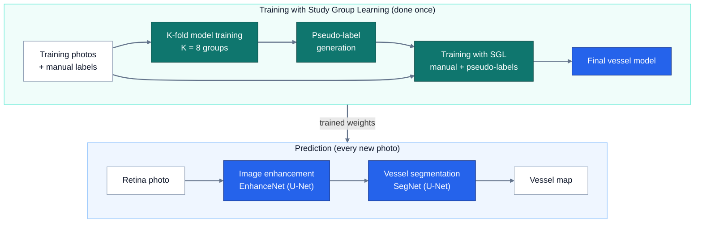

# Retinal Vessel Segmentation with Study Group Learning (SGL)

This project finds the blood vessels in a photo of the back of the eye, pixel
by pixel. It is a PyTorch reproduction of the MICCAI 2021 paper *Study Group
Learning*, using the DRIVE dataset.

> **Status:** the code runs from start to finish. The real DRIVE experiment has
> **not** been run yet, so this README reports no results of its own.


<details>
<summary>Editable version of the diagram (Mermaid)</summary>



</details>

## What the project does

- **Input:** a colour photo of the retina (the back of the eye).
- **Output:** a vessel map, where white means "blood vessel". It also saves a
  probability map and an overlay on the original photo.
- **Training method:** Study Group Learning. Several models label each other's
  images, which helps with vessels that the human annotators missed.

## Dataset: DRIVE

[DRIVE](https://drive.grand-challenge.org/) has 40 retina photos (20 for
training and 20 for testing), each 565 × 584 pixels. Each photo comes with:
- vessels drawn by hand;
- a mask of the round area that shows the eye.

The dataset is **not included** in this repository. Download it and place it
like this (these are the original DRIVE file names):

```
data/DRIVE/
  training/  images/21_training.tif   1st_manual/21_manual1.gif   mask/21_training_mask.gif   (ids 21-40)
  test/      images/01_test.tif       1st_manual/01_manual1.gif   mask/01_test_mask.gif       (ids 01-20)
```

Evaluation needs the test labels (`test/1st_manual/`). Some copies of DRIVE
leave them out.

## How SGL works

**The problem:** hand-drawn labels often miss thin vessels. A model trained
only on those labels learns to miss them too.

**The idea:** let a "study group" of models produce a second opinion for every
training image.

1. Split the 20 training images randomly into **K groups** (K = 8, as in the
   paper).
2. For each group, train a model on the **other** groups. Then let it label the
   images of its own group, which it has never seen. These labels are called
   **pseudo-labels**.
3. Train the final model on **both** label types:
   `loss = BCE(prediction, manual label) + BCE(prediction, pseudo-label)`
4. Use only the final model for prediction.

**SGL is a training method, not a prediction step.** A new photo only goes
through the two networks shown at the top of the diagram:
- **EnhanceNet** makes an enhanced version of the image.
- **SegNet** marks the vessels in it.

To get the final map, the prediction is averaged over 8 flipped copies of the
image and cut off at a probability of 100/255.

## Project structure

```
assets/architecture.svg  diagram used in this README
src/model.py             the model: EnhanceNet + SegNet (two U-Nets)
src/dataset.py           DRIVE loading and augmentation
src/losses.py            SGL loss (manual label + pseudo-label)
src/sgl_labeling.py      SGL: K-fold training and pseudo-labels
src/train.py             train one model
src/run_sgl.py           full pipeline: pseudo-labels -> final model -> test evaluation
src/evaluate.py          test-set evaluation
src/infer.py             predict vessels on your own images
src/metrics.py           accuracy, sensitivity, specificity, AUC, Dice, IoU
src/visualize.py         saves vessel maps, overlays and error images
src/utils.py             device, seeds, checkpoints, 8-way averaging
src/config.py            default paths and settings
```

## Installation

On a Mac:

```bash
python3.11 -m venv .venv
source .venv/bin/activate
pip install -r requirements.txt
```

The device is chosen automatically: CUDA GPU, then Apple MPS, then CPU. To pick
one yourself, use `--device cuda`, `--device mps` or `--device cpu`.

On Google Colab:
1. Choose **Runtime > Change runtime type > GPU**.
2. Clone the repository.
3. Run `pip install -r requirements.txt`.
4. Add `--device cuda --workers 2` to the commands below.

## Training, evaluation and inference

Run these from the project folder.

```bash
# Full pipeline: SGL pseudo-labels -> final model -> one test-set evaluation
python src/run_sgl.py --k 8 --fold-epochs 15 --final-epochs 25

# Or run the steps one by one
python src/sgl_labeling.py --k 8 --epochs 15
python src/train.py --teacher-dir outputs/pseudo_labels --epochs 25 --out-dir checkpoints/final

# Evaluate a saved model on the DRIVE test set
python src/evaluate.py --ckpt checkpoints/final/last.pt

# Vessel map for any retina photo
python src/infer.py --ckpt checkpoints/final/last.pt \
    --images data/DRIVE/test/images/01_test.tif --masks data/DRIVE/test/mask/01_test_mask.gif
```

| Option | What it does |
|---|---|
| `--patch-size 256` | training crop size (the default is 128; the paper uses 256) |
| `--val-ids 37 38 39 40` | hold out these training images and keep the best epoch |
| `--resume` | continue a stopped run |
| `--root PATH` | DRIVE folder, if it is not in `data/DRIVE` |

Run any script with `--help` to see all of its options.

**Where results go:**
- pseudo-labels: `outputs/pseudo_labels/`
- models: `checkpoints/`
- test scores: `outputs/test_results.json`
- vessel maps, overlays and error images: `outputs/test_predictions/`

The test set is used only once, at the end. It is never used to choose a
model. Scores are measured **inside the eye area** (the field of view).

## Status and limitations

- **Results are pending.** The model has not been trained or evaluated on DRIVE
  yet.
- **Paper results, for reference only:** the authors report Se 0.8380,
  Sp 0.9834, Acc 0.9705, AUC 0.9886 and F1 0.8316 on DRIVE. These are the
  paper's numbers, not this project's.
- **No noisy-label experiments yet.** The paper also tests SGL on labels with
  vessels removed on purpose. That part is not included here; the official
  code has a notebook for it.
- **Some settings are not in the paper.** The learning rate, number of epochs,
  batch size and threshold come from the reference code.
- **Files that came with the copied code:** `checkpoints/sgl_final.pt` and
  `outputs/` are not results of this project, and Git ignores them.

## References and credits

- **Paper:** Yuqian Zhou, Hanchao Yu, Humphrey Shi. *Study Group Learning:
  Improving Retinal Vessel Segmentation Trained with Noisy Labels.* MICCAI 2021.
  [arXiv:2103.03451](https://arxiv.org/abs/2103.03451)
- **Official code** (MIT License):
  [SHI-Labs/SGL-Retinal-Vessel-Segmentation](https://github.com/SHI-Labs/SGL-Retinal-Vessel-Segmentation).
  The model in `src/model.py` follows its `model/con.py`.
- **Starting code:** this project began as a copy of
  [Tejmul/Retinal--Vessel-Segmentation](https://github.com/Tejmul/Retinal--Vessel-Segmentation),
  a PyTorch reproduction of the paper.
- **Dataset:** J. Staal et al. *Ridge-based vessel segmentation in color images
  of the retina.* IEEE TMI, 2004.

**What I changed from the starting code:**
- The model is no longer chosen using the test set.
- Scores are measured inside the eye area.
- The code works with the original DRIVE file names.
- Study groups are split randomly, with K = 8 as in the paper.
- Pseudo-labels are 0 outside the eye.
- The image and its labels now get the same warping.
- Random seeds now cover all random numbers.
- Runs can be resumed.
- Added inference and visual outputs.

```bibtex
@inproceedings{zhou2021study,
  title={Study group learning: Improving retinal vessel segmentation trained with noisy labels},
  author={Zhou, Yuqian and Yu, Hanchao and Shi, Humphrey},
  booktitle={International Conference on Medical Image Computing and Computer-Assisted Intervention},
  pages={57--67},
  year={2021},
  organization={Springer}
}
```
