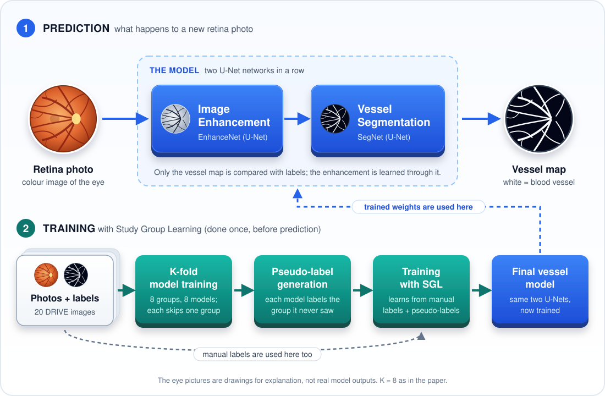

<div align="center">

# 👁️ Retinal Vessel Segmentation · Study Group Learning

**Computer Vision Project**

Prerak Arya (230039) · Abhishek Meena (230137)

*A PyTorch reproduction of* Study Group Learning *(Zhou, Yu & Shi, MICCAI 2021) on the DRIVE dataset*

</div>

---

## At a glance

| | |
|---|---|
| **Task** | Mark every blood-vessel pixel in a colour photo of the retina |
| **Dataset** | DRIVE: 40 fundus photos (20 train, 20 test), 565 × 584 px |
| **Model** | EnhanceNet → SegNet, two U-Nets in a row |
| **Training idea** | Study Group Learning (SGL): models create pseudo-labels for each other |
| **Status** | Pipeline complete and runs end to end · full DRIVE run still to do |



## Hypothesis

Human annotators trace thick vessels well but skip many thin ones. A network trained only on
their labels learns the same blind spots.

> **We expect** that pseudo-labels from a "study group" of models, each labelling images it never
> trained on, recover those missed vessels. Training on manual labels plus pseudo-labels should
> raise **sensitivity** while keeping **specificity** about the same.

## Results

All scores are on the 20 DRIVE test images, measured inside the eye area (field of view),
with 8 flips averaged and a threshold of 100/255. The test set is used once, at the end.

| Metric | Paper (Zhou et al., 2021) | **This project** |
|---|:---:|:---:|
| Accuracy | 0.9705 | ⏳ |
| Sensitivity | 0.8380 | ⏳ |
| Specificity | 0.9834 | ⏳ |
| AUC | 0.9886 | ⏳ |
| F1 / Dice | 0.8316 | ⏳ |
| IoU (vessel) | – | ⏳ |

⏳ = filled in from `outputs/test_results.json` once the full run finishes.
The paper's column is the target, not our output.

**How we will test the hypothesis:** compare the SGL model against the same network trained
without pseudo-labels (`train.py` with no `--teacher-dir`). The hypothesis holds if SGL gives
higher sensitivity at similar specificity.

## How Study Group Learning works

```
20 training images ──► split into K = 8 groups
                         │
        for each group g │  train on the other 7 groups
                         ▼  predict group g  ──►  pseudo-labels (never seen by that model)
                         │
final model ◄── loss = BCE(pred, manual label) + BCE(pred, pseudo-label)
```

SGL changes only training. At prediction time a photo goes through one network once:
**EnhanceNet** cleans up the image, **SegNet** outputs a vessel probability map.

## Run it

```bash
python3.11 -m venv .venv && source .venv/bin/activate
pip install -r requirements.txt

# everything: pseudo-labels → final model → one test evaluation
python src/run_sgl.py --k 8 --fold-epochs 15 --final-epochs 25

# vessel map for your own photo
python src/infer.py --ckpt checkpoints/final/last.pt \
    --images data/DRIVE/test/images/01_test.tif --masks data/DRIVE/test/mask/01_test_mask.gif
```

The device is picked automatically (CUDA → Apple MPS → CPU). On Google Colab, choose a GPU
runtime and add `--device cuda --workers 2`. Every script has `--help`.

<details>
<summary>Dataset layout (DRIVE is not included)</summary>

Download DRIVE from <https://drive.grand-challenge.org/> and keep the original file names:

```
data/DRIVE/
  training/  images/21_training.tif   1st_manual/21_manual1.gif   mask/21_training_mask.gif   (ids 21-40)
  test/      images/01_test.tif       1st_manual/01_manual1.gif   mask/01_test_mask.gif       (ids 01-20)
```
</details>

<details>
<summary>Useful options</summary>

| Option | Effect |
|---|---|
| `--patch-size 256` | training crop size (default 128; the paper uses 256) |
| `--val-ids 37 38 39 40` | hold out training images to pick the best epoch |
| `--resume` | continue a stopped run |
| `--root PATH` | DRIVE folder, if not `data/DRIVE` |
</details>

**Outputs:** pseudo-labels in `outputs/pseudo_labels/`, models in `checkpoints/`, scores in
`outputs/test_results.json`, vessel maps / overlays / error images in `outputs/test_predictions/`.

## Code map

| File | Role |
|---|---|
| `src/model.py` | EnhanceNet + SegNet |
| `src/dataset.py` | DRIVE loading and augmentation |
| `src/losses.py` | SGL loss (manual + pseudo-label) |
| `src/sgl_labeling.py` | K-fold training and pseudo-labels |
| `src/train.py` | train one model |
| `src/run_sgl.py` | full pipeline |
| `src/evaluate.py` · `src/metrics.py` | test evaluation: Acc, Se, Sp, AUC, Dice, IoU |
| `src/infer.py` · `src/visualize.py` | predictions on new images and saved figures |
| `src/utils.py` · `src/config.py` | device, seeds, checkpoints, 8-flip averaging, defaults |

## What we changed from the starting code

This project began as a copy of
[Tejmul/Retinal--Vessel-Segmentation](https://github.com/Tejmul/Retinal--Vessel-Segmentation).
We fixed how it is evaluated and trained:

- ✅ The model is no longer chosen using the test set
- ✅ Scores count only pixels inside the eye area
- ✅ Random study groups with K = 8, as in the paper
- ✅ Image, label and pseudo-label get the same warping
- ✅ Pseudo-labels are 0 outside the eye
- ✅ All random numbers are seeded; runs can be resumed
- ✅ Works with the original DRIVE file names
- ✅ Added inference and visual outputs

Scores that came with the starting code (`checkpoints/sgl_final.pt`, `outputs/`) are not ours
and are ignored by Git.

**Not covered yet:** the paper's noisy-label experiments (labels with vessels removed on purpose).
Learning rate, epochs, batch size and threshold come from the reference code, not the paper.

## Credits

- Y. Zhou, H. Yu, H. Shi. *Study Group Learning: Improving Retinal Vessel Segmentation Trained
  with Noisy Labels.* MICCAI 2021. [arXiv:2103.03451](https://arxiv.org/abs/2103.03451)
- Official code (MIT): [SHI-Labs/SGL-Retinal-Vessel-Segmentation](https://github.com/SHI-Labs/SGL-Retinal-Vessel-Segmentation); `src/model.py` follows its `model/con.py`
- J. Staal et al. *Ridge-based vessel segmentation in color images of the retina.* IEEE TMI, 2004 (DRIVE)

```bibtex
@inproceedings{zhou2021study,
  title={Study group learning: Improving retinal vessel segmentation trained with noisy labels},
  author={Zhou, Yuqian and Yu, Hanchao and Shi, Humphrey},
  booktitle={MICCAI},
  pages={57--67},
  year={2021}
}
```
