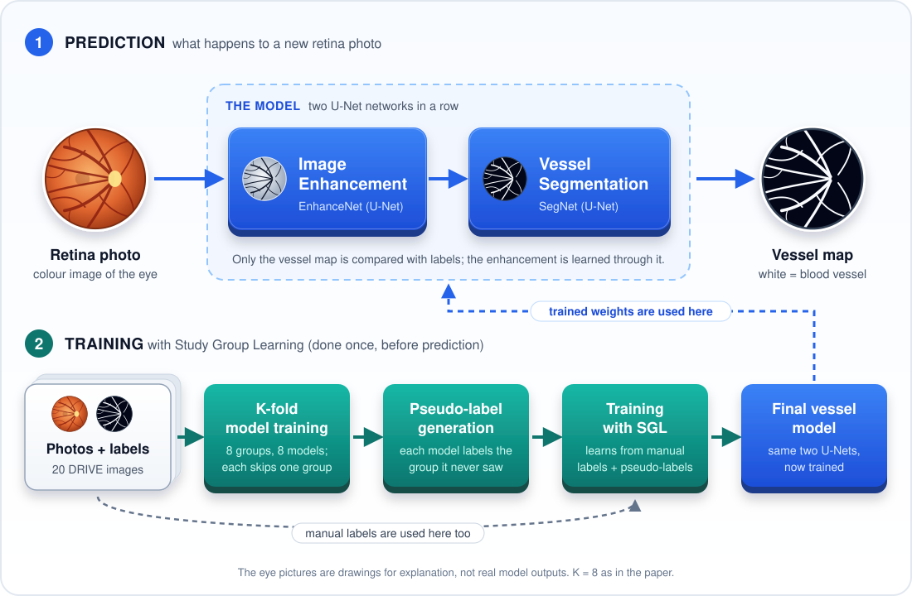

# Retinal Vessel Segmentation with Study Group Learning

Computer vision project by Prerak Arya (230039) and Abhishek Meena (230137).

## Project overview

This PyTorch project segments blood vessels in color retinal fundus images
from DRIVE. The CON model uses an EnhanceNet U-Net followed by a SegNet U-Net
to produce a vessel probability for each pixel.

The experiment compares the same network trained in two ways. The baseline
uses manual vessel annotations. Study Group Learning (SGL) adds predictions
from models that did not train on the images they label. The hypothesis is
that these pseudo-labels increase vessel sensitivity while retaining similar
specificity.



## Report and experiment records

| Milestone | Contents |
|---|---|
| [1. Background and base paper](milestone1/README.md) | Retinal vessel segmentation, CON, and the published DRIVE benchmark |
| [2. Baseline reproduction](milestone2/README.md) | DRIVE setup, manual-label training, and implementation checks |
| [3. Hypothesis and experiment plan](milestone3/README.md) | Expected sensitivity and specificity trade-off and the comparison protocol |
| [4. SGL experiment and evaluation](milestone4/README.md) | Pseudo-label generation, GPU run instructions, and output files |
| [5. Failure analysis and limitations](milestone5/README.md) | Predicted vessel review and interpretation once DRIVE outputs are available |

## Results

The eight core unit tests and the synthetic end-to-end comparison passed. The
project previously validated loading all 40 DRIVE images with their manual
annotations and field-of-view masks. Full DRIVE baseline and SGL scores are
pending.

| Metric | Project baseline | Project SGL | Published SGL (K=8) |
|---|---:|---:|---:|
| Accuracy | Pending | Pending | 0.9705 |
| Sensitivity | Pending | Pending | 0.8380 |
| Specificity | Pending | Pending | 0.9834 |
| ROC-AUC | Pending | Pending | 0.9886 |
| Dice / F1 | Pending | Pending | 0.8316 |
| Vessel IoU | Pending | Pending | 0.7120 |

Published scores are from Zhou et al., Appendix Table 3, at the original label
ratio. This project uses mean per-image metrics inside the retinal field of
view as its primary evaluation. [Paper and benchmark](milestone1/README.md#published-drive-benchmark)

## Dataset and preprocessing

DRIVE has 20 training and 20 test images. Training uses random patches with
spatial augmentation. Pseudo-label generation and evaluation use padded full
images, and predictions are cropped back to the original dimensions. The
dataset is available separately. [DRIVE setup and file layout](milestone2/README.md#local-setup)

## Run the comparison

[](https://colab.research.google.com/github/A-cpu-rg/Retinal-vessel-segmentation-sgl/blob/main/notebooks/full_experiment_colab.ipynb)

Select a GPU runtime in Colab, or install the local dependencies and prepare
DRIVE using the [baseline setup](milestone2/README.md#local-setup). Then run
both models from the repository root.

```bash
python src/run_sgl.py --k 8 --fold-epochs 15 --final-epochs 25 \
  --patch-size 256 --with-baseline
```

The [experiment guide](milestone4/README.md) covers checkpoint selection,
resuming the run, and finding the generated metrics and predictions.

## Repository structure

| Path | Contents |
|---|---|
| [milestone1/](milestone1/) through [milestone5/](milestone5/) | Project documentation in experiment order |
| [src/](src/) | PyTorch model, DRIVE loader, training, SGL, evaluation, and inference |
| [notebooks/](notebooks/) | End-to-end Colab GPU experiment |
| [assets/](assets/) | Architecture diagram |
| [tests/](tests/) | Unit checks and a synthetic pipeline smoke test |
